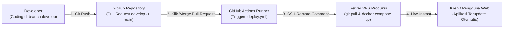

# Panduan Operasional Deployment: Fullstack Monorepo

Dokumentasi resmi alur kerja deployment untuk sistem monorepo terpadu (**crud-fe**, **crud-be**, dan **crud-docker**). Dokumen ini disusun secara praktis ke dalam 2 bagian utama:

1. **Bagian 1: Persiapan Awal (Fresh Server Setup)** — Dari server Linux polosan hingga aplikasi live.
2. **Bagian 2: Alur Pembaruan Kode (Day-2 Operations / Code Updates)** — Cara memperbarui aplikasi saat ada perubahan fitur di Frontend atau Backend tanpa merusak database.

---

## BAGIAN 1: Persiapan Awal (Fresh Server Setup)

Bagian ini dijalankan **hanya sekali** ketika Anda baru pertama kali menyewa server Linux / VPS (Ubuntu 22.04 / 24.04 LTS).

### Langkah 1: Masuk ke Server via SSH

Buka terminal di komputer lokal Anda (PowerShell, Git Bash, atau Terminal macOS/Linux):

```bash
ssh root@IP_SERVER_ANDA
```

*(Ketik `yes` jika muncul konfirmasi host key, lalu masukkan kata sandi VPS Anda).*

### Langkah 2: Perbarui Sistem Operasi & Pasang Firewall

Jalankan perintah ini untuk memperbarui paket sistem dan mengunci port yang tidak terpakai:

```bash
# 1. Perbarui daftar paket dan upgrade sistem operasi
apt update && apt upgrade -y

# 2. Pasang paket dasar yang dibutuhkan
apt install -y curl git ufw htop

# 3. Kunci firewall server (Hanya izinkan SSH, HTTP, dan HTTPS)
ufw allow 22/tcp
ufw allow 80/tcp
ufw allow 443/tcp
ufw --force enable
```

### Langkah 3: Pasang Docker Engine & Docker Compose Resmi

Gunakan installer resmi dari Docker Hub agar kompatibel dengan arsitektur Alpine & Node 22:

```bash
# 1. Unduh dan jalankan installer resmi
curl -fsSL https://get.docker.com -o get-docker.sh
sh get-docker.sh

# 2. Pastikan Docker dan Docker Compose berhasil terpasang
docker --version
docker compose version
```

### Langkah 4: Siapkan Folder Proyek & Clone Repositori

Buat folder kerja di `/var/www/app-crud` dan clone ketiga repositori secara sejajar:

```bash
# 1. Buat folder induk aplikasi
mkdir -p /var/www/app-crud
cd /var/www/app-crud

# 2. Clone masing-masing repositori
git clone git@github-personal:Alhaiza/project-crud-basic-be.git crud-be
git clone git@github-personal:Alhaiza/project-crud-basic-fe.git crud-fe
git clone git@github-personal:Alhaiza/project-crud-basic-docker.git crud-docker

# 3. Verifikasi struktur folder (Wajib sejajar seperti di bawah)
ls -la
```

Struktur direktori di server wajib seperti berikut:

```text
/var/www/app-crud/
├── crud-be/         # Kode Backend Laravel 12
├── crud-fe/         # Kode Frontend Nuxt 4
└── crud-docker/     # Konfigurasi Docker Compose & Ingress
```

### Langkah 5: Konfigurasi Environment Produksi (`.env`)

```bash
# 1. Pindah ke direktori orkestrasi
cd /var/www/app-crud/crud-docker

# 2. Salin template environment
cp .env.example .env

# 3. Buka dan edit file .env
nano .env
```

Sesuaikan nilai untuk keamanan server produksi:

```env
APP_PORT=80
DB_EXTERNAL_PORT=3307
DB_ROOT_PASSWORD=GantiPasswordRootKuatAcak123!
DB_DATABASE=db_project_mono_repo_crud
DB_USERNAME=root
DB_PASSWORD=GantiPasswordRootKuatAcak123!
APP_KEY=base64:HRsXCwVn4TBICEWsZb4eBpB05BTiCaNhq/T0H6Il7wQ=
```

*(Tekan `Ctrl + O`, lalu `Enter` untuk menyimpan, lalu `Ctrl + X` untuk keluar dari nano).*

### Langkah 6: Build Pertama Kali & Menjalankan Aplikasi

Jalankan perintah ini untuk membangun seluruh image kontainer:

```bash
# Bangun dan jalankan seluruh service di latar belakang
docker compose up -d --build
```

Pantau log inisialisasi backend dan migrasi database otomatis:

```bash
docker compose logs -f backend
```

*(Jika log menampilkan `Koneksi basis data MySQL terhubung!` dan `Running migrations`, tekan `Ctrl + C` untuk keluar dari log).*

Periksa status seluruh kontainer:

```bash
docker compose ps
```

*Pastikan:* `crud-database` berstatus `healthy`, serta `crud-backend`, `crud-frontend`, dan `crud-nginx` berstatus `Up`. Aplikasi Anda sekarang sudah live di `http://IP_SERVER_ANDA/`!

### Langkah 7: Menghubungkan Domain & SSL Gratis (HTTPS / Let's Encrypt)

Jika Anda memiliki domain (misal: `app.domainanda.com` yang sudah diarahkan DNS A Record-nya ke IP VPS):

```bash
# 1. Pasang certbot di server host
apt install -y certbot

# 2. Hentikan kontainer Nginx sementara
docker compose stop nginx

# 3. Dapatkan sertifikat SSL otomatis
certbot certonly --standalone -d app.domainanda.com

# 4. Pasang volume sertifikat di docker-compose.yml dan hidupkan kembali
docker compose start nginx
```

---

## BAGIAN 2: Alur Pembaruan Kode (Day-2 Operations / Code Updates)

Bagian ini dijalankan **setiap kali Anda merilis fitur baru** ke GitHub. Anda **tidak perlu mengulang** instalasi server atau mereset database.

### Skenario A: Hanya Frontend (`crud-fe`) yang Ada Update Baru

Jika Anda hanya mengubah tampilan, komponen Vue, CSS, atau layout di Frontend:

```bash
# 1. Masuk ke folder frontend dan tarik kode terbaru
cd /var/www/app-crud/crud-fe
git pull origin develop

# 2. Pindah ke folder orkestrasi
cd ../crud-docker

# 3. Rebuild HANYA kontainer frontend tanpa mematikan database atau backend
docker compose up -d --build --no-deps frontend
```

*Keuntungan:* Database MySQL dan Backend Laravel tidak mati sama sekali (Zero Downtime API).

---

### Skenario B: Hanya Backend (`crud-be`) yang Ada Update Logika / Bugfix

Jika Anda menambah controller, service, atau memperbaiki algoritma tanpa perubahan skema tabel database:

```bash
# 1. Masuk ke folder backend dan tarik kode terbaru
cd /var/www/app-crud/crud-be
git pull origin develop

# 2. Pindah ke folder orkestrasi
cd ../crud-docker

# 3. Rebuild HANYA kontainer backend
docker compose up -d --build --no-deps backend
```

*Catatan:* Skrip `entrypoint.sh` otomatis membersihkan cache lama dan menyegarkan route cache di produksi.

---

### Skenario C: Backend Ada Migrasi Tabel Baru (`create_table` / `add_column`)

Jika update backend menyertakan berkas migration Laravel baru:

```bash
# 1. Masuk ke folder backend dan tarik kode terbaru
cd /var/www/app-crud/crud-be
git pull origin develop

# 2. Pindah ke folder orkestrasi dan rebuild backend
cd ../crud-docker
docker compose up -d --build --no-deps backend

# 3. Skrip entrypoint otomatis menjalankan 'php artisan migrate --force'.
#    Jika ingin memverifikasi status migrasi secara manual:
docker compose exec backend php artisan migrate:status
```

*Penting:* Data yang sudah ada di database **tetap utuh dan aman** karena tabel disimpan di dalam Docker Named Volume `crud_db_data`.

---

### Skenario D: Frontend dan Backend Keduanya Memiliki Update Sekaligus

Jika ada rilis besar (fullstack feature) di mana kedua modul berubah bersamaan:

```bash
# 1. Tarik kode terbaru di folder frontend
cd /var/www/app-crud/crud-fe
git pull origin develop

# 2. Tarik kode terbaru di folder backend
cd /var/www/app-crud/crud-be
git pull origin develop

# 3. Pindah ke folder orkestrasi dan rebuild seluruh aplikasi
cd ../crud-docker
docker compose up -d --build
```

---

### Skenario E: Rollback Cepat (Jika Kode Baru Bermasalah / Error)

Jika update kode terbaru di server mengalami bug kritis dan Anda ingin kembali ke versi sebelumnya secara instan:

```bash
# 1. Masuk ke repositori modul yang ingin di-rollback (misal crud-be)
cd /var/www/app-crud/crud-be

# 2. Kembalikan ke commit hash yang stabil
git checkout <COMMIT_HASH_SEBELUMNYA>

# 3. Pindah ke crud-docker dan rebuild kontainer tersebut
cd ../crud-docker
docker compose up -d --build --no-deps backend
```

---

## Ringkasan Perintah Cepat Pemeliharaan (Cheat Sheet)

| Kebutuhan Operasional | Perintah (Dijalankan dari `crud-docker/`) |
| :--- | :--- |
| **Lihat Status Kontainer** | `docker compose ps` |
| **Pantau Log Semua Service** | `docker compose logs -f` |
| **Pantau Log Khusus API** | `docker compose logs -f backend` |
| **Pantau Log Akses Nginx** | `docker compose logs -f nginx` |
| **Periksa Penggunaan RAM** | `docker stats --no-stream` |
| **Masuk ke Terminal Backend** | `docker compose exec backend sh` |
| **Clear Cache Laravel** | `docker compose exec backend php artisan optimize:clear` |
| **Backup Database MySQL** | `docker compose exec database mysqldump -u root -p${DB_ROOT_PASSWORD} db_project_mono_repo_crud > backup_$(date +%Y%m%d).sql` |
| **Restart Nginx Gateway** | `docker compose restart nginx` |

---

## BAGIAN 3: Otomasi CI/CD Auto-Deploy saat Merge ke `main` (GitHub Actions)

Dengan alur ini, Anda **tidak perlu lagi login SSH manual** setiap kali merilis fitur baru. Cukup lakukan merge Pull Request ke branch `main` di GitHub, maka GitHub Actions akan secara otomatis menghubungkan diri ke server VPS via SSH, melakukan `git pull`, dan me-rebuild kontainer yang bersangkutan dalam hitungan detik.

### 1. Konfigurasi 1 Kali di GitHub Secrets

Agar GitHub Actions memiliki izin untuk melakukan SSH ke VPS Anda, tambahkan 4 kunci rahasia (*Secrets*) pada masing-masing repositori GitHub (`crud-be`, `crud-fe`, dan `crud-docker`):

1. Buka repositori Anda di GitHub.
2. Klik tab **Settings** -> pilih menu **Secrets and variables** -> klik **Actions**.
3. Klik tombol **New repository secret** dan masukkan:

| Nama Secret | Nilai yang Harus Diisi |
| :--- | :--- |
| `SSH_HOST` | Alamat IP Publik VPS Anda (contoh: `103.123.45.67`) |
| `SSH_USER` | Akun pengguna SSH VPS Anda (biasanya `root`) |
| `SSH_KEY` | Kunci Privat SSH (`id_rsa` atau `id_ed25519`) dari komputer Anda yang sudah terdaftar di `~/.ssh/authorized_keys` VPS Anda |
| `SSH_PORT` | Port SSH VPS Anda (default: `22`) |

*(Tips: Jika Anda ingin ketiga repo menggunakan secret yang sama secara otomatis, Anda dapat menyimpannya di level **Organization Secrets**).*

### 2. Alur Kerja Rilis Harian (Workflow)

Setelah GitHub Secrets terkonfigurasi, alur rilis Anda menjadi sangat sederhana:



1. **Pengembangan Fitur:** Kerjakan fitur baru di branch `develop` pada repositori yang bersangkutan (misal `crud-fe`).
2. **Push ke GitHub:** Lakukan `git push origin develop`.
3. **Buka Pull Request:** Di GitHub, buat Pull Request dari branch `develop` ke branch `main`.
4. **Merge Pull Request:** Review kode Anda, lalu klik tombol **"Merge pull request"**.
5. **Auto-Deploy Berjalan:**
   - GitHub Actions mendeteksi ada push/merge baru ke `main`.
   - Workflow `.github/workflows/deploy.yml` otomatis aktif.
   - GitHub melakukan SSH ke VPS, menarik kode terbaru, dan me-rebuild kontainer terkait (`--no-deps`).
   - Anda dapat memantau statusnya di tab **Actions** pada halaman GitHub repositori.
6. **Selesai:** Website langsung terupdate secara otomatis dalam ~30 detik tanpa downtime!
